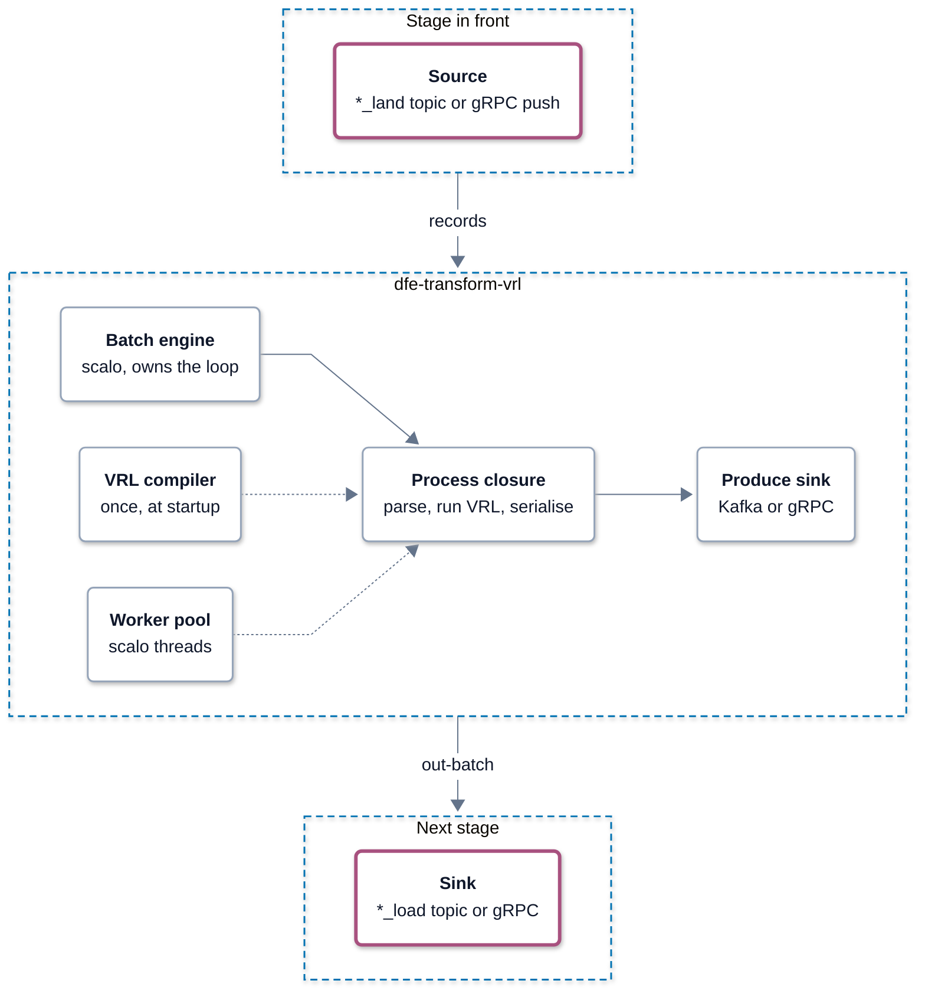

# dfe-transform-vrl architecture

dfe-transform-vrl runs your VRL programs over a DFE source's records, between its land topic and dfe-loader. The VRL engine is compiled into the binary, so there is no Vector process and the memory it uses is bounded.

*Figure 1. L3 Components -- dfe-transform-vrl. The arrows from VRL compiler and Worker pool bring what the closure runs with, not records.* Up: [L2 Services -- DFE deployment](https://github.com/hyperi-io/dfe-infra/blob/main/docs/architecture.md). Down: [L4 Detail -- Process closure](internals.md).

## How data flows

1. The **Batch engine** receives a block of records. On the bus it is a governed Kafka consumer on `{source}_land`. On the direct transport it is a Push listener on port 6000.
2. The **VRL compiler** built one program at startup from every `.vrl` file, in filename order.
3. The **Process closure** parses each record's JSON, runs the program on the **Worker pool** in parallel and serialises the survivors.
4. The **Produce sink** sends the whole out-batch to `{source}_load`, or by gRPC to the next stage's listener.
5. Once the send returns `Ok`, the batch engine releases the block: Kafka commits the offsets, or the Push listener answers its sender.

Source and sink transports are chosen apart, so Kafka in and gRPC out is valid, and the reverse.

## Components

| Part | Role | Page |
|---|---|---|
| Batch engine | scalo's `BatchEngine::pipeline`: receive, process, send, release, with self-regulation on intake | scalo-rs |
| VRL compiler | Compiles the transform files into one program, after checking the memory floor | [internals.md](internals.md#how-it-works) |
| Worker pool | scalo's thread pool the closure runs records on | scalo-rs |
| Process closure | Parses JSON, runs the program, serialises the result | [internals.md](internals.md) |
| Produce sink | Sends the out-batch to Kafka or gRPC | [internals.md](internals.md#interfaces) |

This crate supplies the compiler, the closure, the sink, the config and the enrichment tables. scalo runs the loop.

## External dependencies

| Dependency | Needed for | Swappable |
|---|---|---|
| Kafka | The bus transport, in and out | Any broker `source.brokers` and `sink.brokers` reach. The direct transport needs none |
| A DFE service over gRPC | The direct transport's sink, `http://dfe-loader:6000` by default | Any stage that runs a Push listener |
| Dead-letter queue | Records the sink refuses for good | Kafka or a file directory (`dlq.file.path`) |
| Enrichment table files | `get_enrichment_table_record` and `find_enrichment_table_records` | CSV, JSON, YAML, STIX, MMDB and SQLite, mounted as a file set |

## Deployment variants

| Variant | What runs |
|---|---|
| Kubernetes `single`, `scale`, Docker `single` | On by default. dfe-engine runs one instance per source that binds a VRL transform, and removes it once no source does |
| Kubernetes `slim`, `mesh` | Not deployed by default |

The released chart scales on CPU. Consumer-group lag rises when a downstream stage breaks, and more pods can't fix that, so lag is not a trigger. dfe-infra's values add the scaling-pressure trigger in `single`, `scale` and `mesh`. `slim` scales on CPU alone.

The Push port opens when `config.source.transport` is `direct` or `grpc`. A program change is a change to the transforms file set, and the chart rolls the pod.

## Design considerations

**Security.** The host, network, file and decompression functions (`get_env_var`, `get_hostname`, `http_request`, `dns_lookup`, `reverse_dns`, `parse_proto`, `encode_proto`, `validate_json_schema`, `decode_gzip`, `decode_zlib`, `decode_zstd`, `decode_lz4`, `decode_snappy`) don't compile, and nor do the file arguments `parse_etld`'s `psl` and `parse_groks`' `alias_sources`. A transform can't read the host's environment or files, reach the network, or inflate a record without a bound.

**Reliability.** Delivery is at least once, per batch. A crash between send and release delivers the whole block again, so VRL programs must be idempotent. A record VRL drops still releases its offset, so a filtering transform never stalls its source. Self-regulation brakes intake alone. Braking the sink too would deadlock the loop.

**Operations.** Health and metrics answer on 9090. A transform with no topics or no program starts Ready and idle, with `pipeline_idle` at 1, so it can be deployed before its program exists. A transport reports healthy before it reaches a broker, so a pod that never reached one still reports Ready.

**Performance.** JSON parses with SIMD in sonic-rs. The consumer prefetch and producer queue are bounded by `source.max_buffer_bytes` and `sink.max_buffer_bytes`. Compilation scales with the program, and below the memory floor the start is refused with the numbers, not killed mid-compile.

## Why it's built this way

**VRL in process, not Vector.** Vector has no memory cap, so a pod limit has to cover the worst case Vector might reach. Most pipelines use VRL alone. A pipeline that needs `lua`, `aggregate`, `dedupe`, `throttle` or `sample` uses [dfe-transform-vector](https://github.com/hyperi-io/dfe-transform-vector), which keeps the subprocess and pays for it.

| Aspect | dfe-transform-vrl | dfe-transform-vector |
|--------|-------------------|---------------------|
| Transform engine | VRL crate (in-process) | Vector subprocess |
| Kafka source/sink | scalo's `KafkaTransport` over rdkafka (wrapper-controlled) | Vector-managed |
| Memory control | Bounded consumer and producer buffers, scalo's memory guard | None (Vector unbounded) |
| Supported transforms | VRL | All Vector transforms |
| Container image size | Smaller (Rust binary) | Larger (Rust + Vector) |
| Process model | Single process | Wrapper + subprocess |
| Startup time | Fast (compile VRL) | Slower (spawn + healthcheck Vector) |
| Crash recovery | Restart binary | Restart subprocess + binary |

**Compile once.** The program is immutable for the process lifetime. Tables and functions are fixed when it compiles, and a roll is the one way to change either.

**scalo owns the loop.** The batch engine, governor and Kafka transport are the same in every DFE Rust service, so this crate holds the transform and nothing else.

**JSON as the one format.** MessagePack was dropped in DFE 2.2. A record that isn't JSON is dropped and counted, never redelivered.

## Diagram map

- [Figure 1. L3 Components -- dfe-transform-vrl](architecture.md)
  - [L4 Detail -- Process closure](internals.md)

## What's next

- [config.example.yaml](../config.example.yaml), the annotated config, and [config-schema.yaml](config-schema.yaml), every key
- [reference/configuration.md](reference/configuration.md), env overrides, Kafka TLS, what reloads and the chart
- [pipelines/filebeat/README.md](../pipelines/filebeat/README.md), the legacy filebeat bundle
- [CONTRIBUTING.md Context](../CONTRIBUTING.md#context), where things live and the commands that test a change
