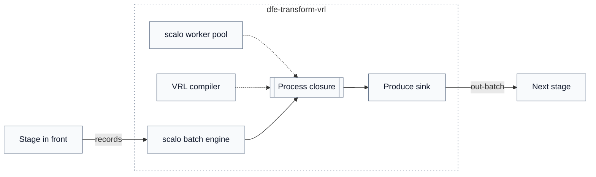

# Architecture

Why dfe-transform-vrl is built this way and the invariants it keeps. The per-record path, memory budget and reload matrix are in [internals.md](internals.md).

## The problem the wrapper solves

Vector costs memory DFE cannot afford at volume.

Vector has no configurable memory cap. Its internal buffers grow with throughput, so a Kubernetes memory limit has to be sized for the worst case Vector might reach rather than the work that is queued.

That cost buys access to Vector's non-VRL transforms, which most pipelines never use. So the answer is to keep VRL and drop Vector. Compile the VRL crate into the binary, and let the wrapper hold the buffers and the wire format.

One Rust binary. It reads records, runs a compiled VRL program over each one, and writes the results out. Kafka in and out on the `bus` transport, gRPC in and out on the `direct` transport (`0.0.0.0:6000` listener, default sink endpoint `http://dfe-loader:6000`).

It is not a general transform host: a pipeline needing a Vector-native transform -- `lua`, `aggregate`, `dedupe`, `throttle`, `sample` -- belongs in dfe-transform-vector, which keeps the subprocess and pays for it.

## Who owns the loop

scalo's `BatchEngine::pipeline` drives `recv -> process -> send -> release`, including the held source acknowledgement and self-regulation. This crate supplies the `process` closure and the produce sink, plus the config, the VRL compiler and the enrichment registry.

This diagram shows the parts inside dfe-transform-vrl that a block of records passes through.

*Figure 1. L3 Components -- dfe-transform-vrl. Dotted arrows bring what the closure runs with, not records.* Up: top of dfe-transform-vrl. Down: [L4 Detail -- Process closure](internals.md#data-flow).

scalo holds the batch engine and the worker pool. This crate holds the compiler, the process closure and the produce sink. On the bus the stage in front and the next stage are Kafka topics. On the direct transport the stage in front pushes to this service's listener, and the next stage is another Push listener. scalo's self-regulation governor sits on the engine's intake.

Per block of records:

1. The loop receives a `WorkBatch` from the source. On the bus transport that is the governed Kafka consumer: the inbound brake is attached, so intake pauses under memory pressure by pausing partitions -- the member stays in the consumer group and no rebalance fires. On the direct transport it is the Push listener, which rejects pushes `UNAVAILABLE` under the same pressure.
2. `process` parses each record's JSON into a VRL `Value`, runs the compiled program on the worker pool in parallel, and serialises the survivors back to JSON.
3. The loop sends the whole out-batch through `TransportSender::send_batch`.
4. The loop releases the block's source after the send returns `Ok`: Kafka commits the offsets, the Push listener answers its sender OK.

## Invariants: the delivery contract

**At-least-once is batch-level, not per record.** The source is released after the batch send succeeds. A crash between send and release re-delivers the whole block, so **VRL programs must be idempotent**. There is no exactly-once path and no per-record commit to fall back on.

**A Push is answered once its records are delivered.** The listener is built armed, so a sender waits for a Kafka delivery report or the next hop's answer. A send that fails for a recoverable reason is retried until the hold runs out (at most 18 s, less under a shorter sender deadline), then answered `UNAVAILABLE`, and a permanent failure stops the loop. The next hop gets at most 15 s inside that hold: the gRPC sink's deadline, or Kafka's `message.timeout.ms` capped at 15 s unless `sink.librdkafka_options` sets it. `source.acknowledgements.enabled: false` answers at receipt, and a crash or failed send then loses what was answered.

**Dropped records still ack.** When a VRL `abort` or a transform error removes a record from a block, the block's `commit_tokens` -- the source offsets -- flow through untouched, and the block releases as dropped, not delivered. A block the sink filters out rather than sends releases the same way. A transform that filters most of its input therefore never under-acks its source, and a pipeline cannot stall because a batch emitted fewer records than it consumed.

**The outbound drain is never gated.** Self-regulation brakes intake alone. Applying the same backpressure to the producer would deadlock the pipeline: the loop cannot drain the sink it is being blocked on. Any future work on backpressure has to keep that asymmetry.

## Invariants: startup and runtime state

**VRL is compiled once, at startup, and is then immutable for the process lifetime.** Transform files are read in sorted filename order and concatenated into a single program. Changing a transform means rolling the pod -- hence `hot_reload: false` and `reload: roll` in the suite manifest. There is no recompile path at runtime.

**The compile memory floor is checked before the compiler runs.** Compilation is the one startup cost that scales with the deployment's data. Below a certain container limit the kernel kills the process mid-compile, which an operator sees as an exit-137 restart loop with nothing in the log naming the cause. `engine::budget` reads the limit first and rejects the start with all three numbers -- program size, limit, required floor -- in one message. Its two constants, a reserve and a cost per source byte, come from runs on the shipped image, and their doc comments give the data points.

**Idle is a valid, Ready state.** A transform instance is deployed before its program exists -- whatever creates it writes the config with its topics, and the VRL arrives afterwards. With no topics on the bus, or no program, the app starts, reports Ready, holds `pipeline_idle` at 1, joins no consumer group, and logs the reason once. scalo's idle gate re-reads the config when the config file changes or the process gets a SIGHUP, and a program written into `transforms.dir` alone does not wake it. In Kubernetes a program change is a change to the transforms file set, which rolls the pod.

**Metric names are emitted bare.** The `MetricsManager` namespace is empty unless `metrics.namespace` is set, and none is by default. A set namespace is prepended once by the global recorder's prefix layer, so app code passing a prefixed name doubles it. Apps are told apart by Prometheus label, never by metric name.

**Enrichment tables are materialised once and swapped atomically.** File, STIX and SQLite tables load into an `FxHashMap` keyed on the key columns and swap through `ArcSwap`. A case-sensitive equality lookup on the key columns reads one bucket, and any other lookup scans the rows. MMDB tables use their reader, loaded once. Background refresh is opt-in per table and the interval is clamped to a 60 second minimum. Custom VRL functions (`get_enrichment_table_record`, `find_enrichment_table_records`) are registered beside the VRL stdlib, backed by a registry captured at compile time -- which is why a table cannot appear after startup.

## Two config authorities, one config file

The `--config` file plus `DFE_TRANSFORM_VRL_*` env vars resolve this crate's `Config`: `pipeline`, `source`, `sink`, `transforms`, `enrichment_tables`, `dlq`.

scalo resolves its sections -- `metrics`, `logger`, `memory`, `scaling`, `worker_pool`, `batch_processing`, `self_regulation`, `version_check`, `otel_tracing` -- from a separate cascade, which scalo's `run_app` sets up with the `--config` file as its settings layer before the wrapper loads its config. So the mounted config has both, each authority taking the sections it owns. The env layer outranks the file for both, and there a scalo section nests on a double underscore. `--config` is the one way to name the file: `DFE_TRANSFORM_VRL_CONFIG` reaches neither cascade. A `config.yaml` read from the working directory with no `--config` reaches the wrapper alone, so the wrapper warns at startup for each section `config::SCALO_CASCADE_SECTIONS` lists, rather than letting the deployment believe it took.

A second list, `config::INERT_SETTINGS`, covers fields this crate accepts and validates but does not act on, each with the reason and the replacement where one exists. `HotConfig` and `ConfigReloader` re-read and re-validate the file on change or SIGHUP, so a bad edit logs `Config reload failed, keeping current config` without a restart, but every field in the reloadable subset is on the inert list -- no pipeline behaviour changes on reload.

## Components

| Path | Holds |
|---|---|
| `src/main.rs`, `src/cli.rs` | Process entry, subcommands, the scalo `ServiceApp` wiring |
| `src/pipeline.rs` | The `process` closure and sink handed to scalo's batch engine |
| `src/engine/compiler.rs` | Loads and compiles transform files into one program |
| `src/engine/runner.rs` | Runs a compiled program against one event `Value` |
| `src/engine/budget.rs` | Compile memory floor, checked before compiling |
| `src/config/` | `Config`, validation, `HotConfig`, the inert and cascade lists |
| `src/enrichment/` | Table loading (CSV, JSON, YAML, MMDB, STIX, SQLite), refresh, the VRL functions |
| `src/kafka/mod.rs` | The consumer and producer configs for scalo's `KafkaTransport`, and the DFE topic and group names |
| `src/deployment.rs` | `contract()` -- the source the Dockerfile and the released chart are generated from |
| `src/metrics.rs` | Three metric layers, bare names |
| `pipelines/filebeat/` | Opt-in legacy data bundle, not engine capability |

## Deployment

The `Dockerfile` is generated from `deployment.rs::contract()` by scalo's generator, and has a header naming the generator and the contract schema version. `emit-dockerfile` regenerates it, and `checked_in_dockerfile_matches_emit_dockerfile` fails on a hand edit, so a fix belongs in `contract()`.

No chart is committed. At release, hyperi-ci emits the contract with `generate-artefacts` and assembles a thin chart from it on the scalo-service library chart at `release.helm.library`. `dfe-transform-vrl emit-contract` prints the contract: the startup budget, `kubernetes.io/h2c` on the Push port, the Kafka Secret mounted into the per-endpoint SASL names and the shared mechanism name, the DLQ's directory as the one writable path under a read-only root beside the library's scratch `/tmp`, the requests and limits, and the grace period.

The Push port (6000) is gated on `config.source.transport` being `direct` or `grpc`, the two names of the one transport that binds the listener, so the bus default (`bus` or `kafka`) publishes no port nothing answers on. The contract's ScaledObject scales on CPU alone: consumer-group lag rises when a downstream stage breaks, so it is not a trigger. A deployment adds a trigger with the library's `keda.extraTriggers` value. In a DFE deployment, dfe-infra's values set the CPU target in every profile. The single, scale and mesh profiles add the scaling-pressure trigger, read through dfe-keda-shim, and slim runs on CPU alone. The engine's [KEDA scaling page](https://github.com/hyperi-io/dfe-engine/blob/main/docs/deployment/keda-scaling.md) covers the triggers for every app.

The suite manifest, `dfe-infra/apps.yaml`, is the authority on how many instances run, not this repo. It declares `multiplicity: per_config` -- one deployment per source config, never a singleton -- with `scale_deployed: true`, both transports, and a source binding that derives `{source}_land` as the input topic, `{source}_load` as the output, and `dfe-transform-vrl-{source}` as the consumer group. Adding a source is a manifest edit, not a change here.

## Known gaps

Readiness reads scalo's health registry, so a broker refusing the credentials, a missing topic or a consumer that cannot recover takes the pod out of service once the client meets it. But a scalo transport registers healthy before it has reached a broker, so a pod that has never reached its broker still reports Ready.

Rotating the Kafka credential does not roll the pods by default: the env it lands in resolves at pod start, and the library chart's `reload.enabled` and `reload.secrets` values add the Stakater Reloader annotations that roll them, on a cluster that runs Reloader.
