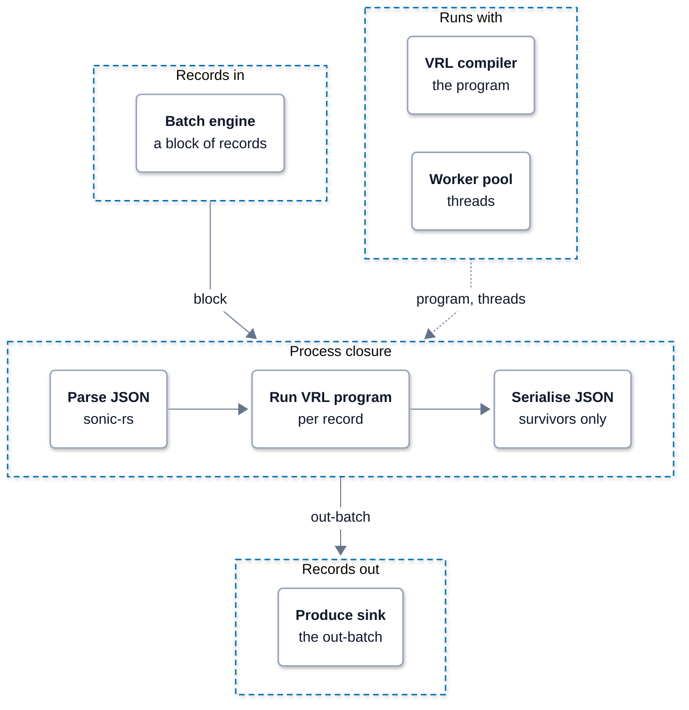

# Process closure

The process closure is the part of [dfe-transform-vrl](architecture.md) that turns each block of records into an out-batch: parse, run the VRL program, serialise.

| | |
|---|---|
| Repo | [hyperi-io/dfe-transform-vrl](https://github.com/hyperi-io/dfe-transform-vrl), `src/pipeline.rs`, `src/engine/` and `src/enrichment/` |
| Image and chart | `ghcr.io/hyperi-io/dfe-transform-vrl`, and the thin chart each release assembles from `src/deployment.rs` |
| Config reference | `transforms`, `enrichment_tables` and `batch_processing` in [config.example.yaml](../config.example.yaml), and [reference/configuration.md](reference/configuration.md) |
| Endpoints | Push listener on 6000 on the direct transport. Metrics and health on 9090 |
| Metrics | `records_received_total`, `records_delivered_total`, `records_error_total{stage}`, `abort_total` on `:9090/metrics` |

It runs on the worker pool's threads, so a block's records run in parallel. The batch engine around it decides when a block arrives and when it is released.



*Figure 1. L4 Detail -- Process closure. The dotted arrow brings what the closure runs with, not records.* Up: [L3 Components -- dfe-transform-vrl](architecture.md).

## How it works

1. `sonic_rs::from_slice` parses each payload straight into a VRL `Value`. A record that isn't JSON, or nests deeper than sonic-rs accepts, is dropped.
2. The compiled program runs on the value in place.
3. `sonic_rs::to_vec` serialises each survivor, keyed by the sink topic.
4. The batch engine sends the out-batch with `TransportSender::send_batch` and releases the block once the send returns `Ok`.

A record that doesn't parse is counted in `records_error_total{stage="deserialise"}`, logged at debug (sampled) and reported to the security log by reason, with nothing from the record. Its block releases as dropped, so it is not redelivered.

The compiler runs once at startup, against VRL's stdlib less `get_hostname`, plus the two enrichment functions. The `.vrl` files in `transforms.dir` load in filename order, then `transforms.files` in the order given, and concatenate into one program, as Vector's `remap` does. A compile error quotes the failing line and stops startup.

`abort` drops a record and counts it in `abort_total`. Any other runtime error drops it and counts it in `records_error_total{stage="transform"}`. A panic inside VRL, which grok and arithmetic functions can raise on record data, fails that record, not the process, because the release profile unwinds. A zone-less `parse_timestamp` reads UTC on every node.

## Interfaces

| Transport | As the source | As the sink |
|---|---|---|
| `bus` (or `kafka`) | A Kafka consumer | A Kafka producer |
| `direct` (or `grpc`) | A Push listener on 6000 | A gRPC client to the next stage's listener |

Transform files hold raw VRL, not Vector YAML:

```vrl
# transforms/01_parse.vrl
.parsed = parse_json!(.message)
del(.message)

# transforms/02_enrich.vrl
.environment = string(.labels.env) ?? "unknown"
.processed_at = now()
```

`get_env_var`, `get_hostname`, `http_request`, `dns_lookup` and `reverse_dns` fail to compile as undefined functions. `parse_proto` and `encode_proto` read their descriptor file at compile time. `validate_json_schema` reads its schema when the first record reaches the call, and a bad schema then fails each such record as a transform error.

Enrichment tables are read with `get_enrichment_table_record` and `find_enrichment_table_records`. File, STIX and SQLite tables load into a hash map on their key columns and swap atomically, so a case-sensitive equality lookup on the key reads one bucket and any other lookup scans the rows. MMDB tables use their reader. A table with a `refresh` block reloads in the background, no more than once every 60 s. A table can't appear after startup, because the program checks its lookups against the tables when it compiles.

`pipelines/filebeat/` is a legacy, opt-in bundle that keeps DFE 2.0 and 2.1 filebeat feeds (Cisco Meraki, IOS, Umbrella) working. It is one VRL file plus `timezones.csv`, and the engine has no code for it. Any other feed uses dfe-transform-elastic. [pipelines/filebeat/README.md](../pipelines/filebeat/README.md) has the wiring.

## Scaling and failure

The wrapper bounds the buffers it holds:

| Buffer | Setting |
|---|---|
| Consumer prefetch | `source.max_buffer_bytes`, librdkafka's `queued.max.messages.kbytes` |
| Transform chunk | `batch_processing.max_chunk_size`, a scalo section |
| Producer queue | `sink.max_buffer_bytes`, librdkafka's `queue.buffering.max.kbytes` |
| Pod memory | The container limit, with the chart default in `src/deployment.rs` |

Those buffers, the compiled program and the enrichment tables share the pod's limit. A full producer queue comes back as backpressure, and the loop retries that block before reading another. A single fetch can go past the prefetch threshold. Under memory pressure scalo's governor pauses the assigned partitions without leaving the consumer group, and on the direct transport the listener answers `UNAVAILABLE`.

Compilation is the one startup cost that scales with the data. `engine::budget` reads the container limit before compiling and refuses a start below the floor, naming the program size, the limit and the floor. Without it the kernel kills the process mid-compile, an exit-137 loop with nothing in the log.

A Push is answered once its records are delivered. A recoverable send failure is retried for at most 18 s, then answered `UNAVAILABLE`. The next hop gets at most 15 s of that. `source.acknowledgements.enabled: false` answers at receipt, and a crash then loses what was answered.

## Key metrics

| Metric | Healthy when |
|---|---|
| `records_received_total` and `records_delivered_total` | Delivered tracks received, less what VRL drops |
| `records_error_total{stage}` | Flat. `deserialise` is bad input, `transform` is a program error |
| `abort_total` | Matches what the program means to filter |
| `execute_duration_seconds` | Steady. A climb is a heavier program or bigger records |
| `pipeline_idle` | 0 once a source binds the transform |

## Related

- [Configuration](reference/configuration.md), env overrides, Kafka TLS, what reloads and the chart
- [dfe-transform-vector](https://github.com/hyperi-io/dfe-transform-vector), for Vector's transforms beyond `remap`
- [tests/TESTING.md](../tests/TESTING.md), the test tiers
