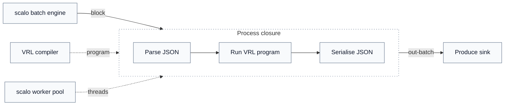

# Internals

How a record moves through dfe-transform-vrl, and the settings behind each step. [architecture.md](architecture.md) covers why the service is built this way and the invariants it keeps.

## Data flow

The process closure parses each record from JSON, runs the compiled VRL program on it and serialises the result back to JSON, on the worker pool's threads.



*Figure 2. L4 Detail -- Process closure. Dotted arrows bring what the closure runs with, not records.* Up: [L3 Components -- dfe-transform-vrl](architecture.md#who-owns-the-loop).

`source.transport` and `sink.transport` are chosen apart, so Kafka in and gRPC out, or the reverse, is valid. The closure is the same for every pair:

| Transport | As the source | As the sink |
|---|---|---|
| `bus` (or `kafka`) | A Kafka consumer | A Kafka producer |
| `direct` (or `grpc`) | A Push listener | A gRPC client, to the next stage's listener |

Per record:

1. `sonic_rs::from_slice` parses the payload straight into a VRL `Value`, which is serde-compatible. A record that is not JSON, or nests deeper than sonic-rs accepts, is dropped.
2. The compiled program runs on the value in place, in parallel on scalo's worker pool.
3. `sonic_rs::to_vec` serialises each survivor back to JSON, keyed by the sink topic.
4. The loop sends the whole out-batch with `TransportSender::send_batch`.

Release is batch-level. scalo's batch engine hands a block of records to the transform, sends the result, and releases the block's source offsets once the batch send returns Ok. Under that, scalo's Kafka transport holds each source offset it handed out and commits a partition up to its lowest unreleased one, so the cumulative commit never passes a record not yet released.

If the process crashes between send and release, the whole block is re-consumed and re-processed (at-least-once, not exactly-once). VRL transforms must be idempotent.

JSON is the one payload format. MessagePack, supported in DFE/XDR 2.0 and 2.1, is deprecated in DFE 2.2 and no longer accepted. JSON parses with SIMD in sonic-rs, and the Kafka sink compresses with `sink.compression`, zstd by default. A record that does not parse as JSON is removed from its block, counted in `records_error_total{stage="deserialise"}`, logged at debug level with the parse error (sampled), and reported to the security log by reason, with nothing from the record. The block's source is then released `Dropped`, so the record is not redelivered.

## VRL integration

`compile_vrl` compiles the source once, at startup, against VRL's stdlib less `get_hostname`, plus the two enrichment functions, with the enrichment registry in the compile config. A compile error quotes the line that failed and stops startup. The compiled `Program` is reused for every event, with no per-event compilation.

`run_vrl` wraps each event in a `TargetValueRef` with an empty metadata object, and resolves it with UTC as the default timezone, so a zone-less `parse_timestamp` reads the same on every node. `abort` drops the event and counts it as filtered. Any other runtime error drops it and counts it in `records_error_total{stage="transform"}`. A panic inside VRL, which its grok and arithmetic functions can raise on record data, fails that record rather than the process, because the release profile unwinds.

vrl is built without its `enable_env_functions` and `enable_network_functions` features, and `compile_vrl` drops `get_hostname` from the system functions it keeps for `parse_etld`. A program calling `get_env_var`, `get_hostname`, `http_request`, `dns_lookup` or `reverse_dns` fails to compile as a call to an undefined function. `parse_proto` and `encode_proto` stay, and read the descriptor file their literal path names at compile time. `validate_json_schema` stays as well, and reads its schema file when the first event reaches the call, keeping it once it compiles. A missing or invalid schema passes compilation and then fails each such event as a transform error.

Transform files contain raw VRL source code (not Vector YAML):

```vrl
# transforms/01_parse.vrl
.parsed = parse_json!(.message)
del(.message)

# transforms/02_enrich.vrl
.environment = string(.labels.env) ?? "unknown"
.processed_at = now()
```

The `.vrl` files in `transforms.dir` load in sorted filename order, then the paths in `transforms.files` in the order given, and they concatenate into a single VRL program. This matches Vector's remap transform, where multiple VRL statements execute in sequence.

`pipelines/filebeat/` ships a legacy, opt-in port of the DFE 2.1 Vector filebeat templates (Cisco Meraki logs, Cisco IOS, Cisco Umbrella) as one pure-VRL file plus its `timezones.csv` enrichment table. It keeps DFE/XDR 2.0 and 2.1 filebeat feeds working, takes no further modules, and any other feed uses dfe-transform-elastic. To use it, point the standard `transforms.dir` and `enrichment_tables` config at those files. The engine has no filebeat-specific code, and the integration tests (`tests/integration/filebeat_pipeline.rs`) drive the bundle with the synthetic cases in `tests/fixtures/filebeat/cases.yaml`, which double as a full-engine workload. Wiring, routing, limitations and the regeneration tooling (`scripts/filebeat/`) are in [pipelines/filebeat/README.md](../pipelines/filebeat/README.md).

## Memory budget

The wrapper bounds the buffers it holds. [config-schema.yaml](config-schema.yaml) has the defaults for the wrapper's keys, and scalo's `BatchProcessingConfig` the default chunk size.

| Component | Configuration |
|-----------|--------------|
| Consumer prefetch | `source.max_buffer_bytes`, set as librdkafka's `queued.max.messages.kbytes` |
| Transform chunk | `batch_processing.max_chunk_size`, a scalo section, from the `--config` file or the env layer |
| Producer queue | `sink.max_buffer_bytes`, set as librdkafka's `queue.buffering.max.kbytes` |
| Total pod memory | The container memory limit, with its chart default set in `src/deployment.rs::contract()` |

The consumer and producer buffers have to fit within the pod memory limit beside the binary, the runtime, the compiled program and the enrichment tables. A full producer queue comes back from the send as backpressure, and the loop retries that block before it reads another, so intake waits on the sink. `source.max_buffer_bytes` sets librdkafka's prefetch threshold, clamped and overridable through `source.librdkafka_options`, and a single fetch can go past it. Under memory pressure scalo's governor pauses the assigned partitions, and on the direct transport the listener rejects pushes `UNAVAILABLE`.

## Comparison: dfe-transform-vrl vs dfe-transform-vector

| Aspect | dfe-transform-vrl | dfe-transform-vector |
|--------|-------------------|---------------------|
| Transform engine | VRL crate (in-process) | Vector subprocess |
| Kafka source/sink | scalo's `KafkaTransport` over rdkafka (wrapper-controlled) | Vector-managed |
| Memory control | Bounded consumer and producer buffers, scalo's memory guard | None (Vector unbounded) |
| Supported transforms | VRL | All Vector transforms |
| Container image size | Smaller (Rust binary) | Larger (Rust + Vector) |
| Process model | Single process | Wrapper + subprocess |
| Startup time | Fast (compile VRL) | Slower (spawn + healthcheck Vector) |
| Crash recovery | Restart binary | Restart subprocess + binary |

Use dfe-transform-vrl for VRL-only transforms (the common case), memory-constrained pods and high-density deployments. Use dfe-transform-vector for pipelines needing Vector-native transforms (`lua`, `aggregate`, `dedupe`, `throttle`, `sample`), or complex multi-source/sink routing.

## Reload

`ConfigReloader` (file polling + SIGHUP) re-reads and re-validates the file and swaps `SharedConfig<HotConfig>`. A bad edit logs `Config reload failed, keeping current config` and counts in `config_reloads_total{result="error"}`, and the service keeps running. The reloadable subset has three fields, and the pipeline reads none of them:

| Field | What it would control | State |
|-------|----------------------|-------|
| `pipeline.batch_size` | Events per transform chunk | not applied -- the chunk size is `batch_processing.max_chunk_size`, a scalo section |
| `pipeline.batch_timeout_ms` | Max wait before flushing partial batch | not applied -- no such timer |
| `sink.key_field` | Kafka partition key path | not applied -- scalo-rs#37 |

`config::INERT_SETTINGS` lists those three and `source.commit_interval_ms`, which the production Kafka profile leaves unread because librdkafka auto-commit is off and the engine commits after each sink ack. The wrapper warns at startup for each one a deployment has moved off its default.

The fields below are bound to connections, compiled programs, or server sockets set up at startup. Changing them needs a pod restart, and the chart rolls the pods: a config change alters the `checksum/config` annotation on the pod template.

| Field | Why |
|-------|-----|
| `pipeline.name` | The producer's `client.id` and the log fields. The consumer group is `source.group_id` |
| `source.*` | rdkafka consumer or Push listener: connection, subscription, auth, TLS, buffers |
| `sink.transport`, `sink.endpoint` | The sink built at startup |
| `sink.brokers` | rdkafka producer connection |
| `sink.topic` | Output topic (changing mid-stream risks data loss) |
| `sink.compression` | rdkafka `compression.type` |
| `sink.sasl.*` / `sink.tls.*` | Security protocol |
| `sink.max_buffer_bytes` | rdkafka `queue.buffering.max.kbytes` |
| `sink.librdkafka_options` | librdkafka `ClientConfig` |
| `transforms.*` | VRL programs compiled at startup |
| `enrichment_tables` | Tables loaded at startup, and the compiled program checks its lookups against them |
| `dlq.*` | The dead-letter queue spawned at startup |

## Operating notes

The transform's sections are `pipeline`, `source`, `sink`, `transforms`, `enrichment_tables` and `dlq`, and [config-schema.yaml](config-schema.yaml) lists every key in them. `--config` is the one way to name the file: `DFE_TRANSFORM_VRL_CONFIG` reaches neither the wrapper nor scalo, and with no `--config` the wrapper reads `config.yaml` or `config.yml` from the working directory.

The big dials have flat env var overrides for K8s. These are every flat name `apply_flat_env` in `src/config/loader.rs` reads:

| Env Var | Config Field |
|---------|-------------|
| `DFE_TRANSFORM_VRL_PIPELINE_NAME` | `pipeline.name` |
| `DFE_TRANSFORM_VRL_KAFKA_SASL_USERNAME` | `source.sasl.username` + `sink.sasl.username` |
| `DFE_TRANSFORM_VRL_KAFKA_SASL_PASSWORD` | `source.sasl.password` + `sink.sasl.password` |
| `DFE_TRANSFORM_VRL_KAFKA_SASL_MECHANISM` | `source.sasl.mechanism` + `sink.sasl.mechanism` |
| `DFE_TRANSFORM_VRL_KAFKA_SECURITY_PROTOCOL` | `source.tls.enabled` + `sink.tls.enabled`, set true when the value contains `SSL`, never set false |
| `DFE_TRANSFORM_VRL_SOURCE_TRANSPORT` | `source.transport` (`bus`, `kafka`, `direct` or `grpc`) |
| `DFE_TRANSFORM_VRL_SOURCE_LISTEN` | `source.listen` |
| `DFE_TRANSFORM_VRL_SOURCE_BROKERS` | `source.brokers` |
| `DFE_TRANSFORM_VRL_SOURCE_TOPICS` | `source.topics` |
| `DFE_TRANSFORM_VRL_SOURCE_GROUP_ID` | `source.group_id` |
| `DFE_TRANSFORM_VRL_SOURCE_SASL_USERNAME` | `source.sasl.username` |
| `DFE_TRANSFORM_VRL_SOURCE_SASL_PASSWORD` | `source.sasl.password` |
| `DFE_TRANSFORM_VRL_SINK_TRANSPORT` | `sink.transport` (`bus`, `kafka`, `direct` or `grpc`) |
| `DFE_TRANSFORM_VRL_SINK_ENDPOINT` | `sink.endpoint` |
| `DFE_TRANSFORM_VRL_SINK_BROKERS` | `sink.brokers` |
| `DFE_TRANSFORM_VRL_SINK_TOPIC` | `sink.topic` |
| `DFE_TRANSFORM_VRL_SINK_KEY_FIELD` | `sink.key_field` |
| `DFE_TRANSFORM_VRL_SINK_COMPRESSION` | `sink.compression` |
| `DFE_TRANSFORM_VRL_SINK_SASL_USERNAME` | `sink.sasl.username` |
| `DFE_TRANSFORM_VRL_SINK_SASL_PASSWORD` | `sink.sasl.password` |
| `DFE_TRANSFORM_VRL_TRANSFORMS_DIR` | `transforms.dir` |

An empty value reads as unset. Every other key of the same sections takes the double-underscore form, `DFE_TRANSFORM_VRL_SINK__TOPIC` for `sink.topic`, and a flat name outranks it.

The chart mounts the Kafka Secret's `username` and `password` into both endpoint pairs, and its `sasl.mechanism` (`PLAIN`, `SCRAM-SHA-512`) into `KAFKA_SASL_MECHANISM`. Outside the chart the shared `KAFKA_SASL_*` names reach both endpoints, and the per-endpoint names override them.

Either half turns SASL on, an enabled block still missing one once the env layer has run stops startup, and the password is redacted on every output path (`x-scalo-secret` + `writeOnly` in the emitted schema).

For Kafka over TLS with a private CA: `tls.ca_cert_file` is a path, and the chart mounts no certificate file. Put the CA's PEM text in the rendered config instead:

```yaml
config:
  source:
    tls:
      enabled: true
    librdkafka_options:
      ssl.ca.pem: |
        -----BEGIN CERTIFICATE-----
        ...
        -----END CERTIFICATE-----
```

The same two keys go under `sink`. A CA is public, so a ConfigMap can hold it. Mutual TLS is not supported through the chart, which mounts no client key. KEDA scales on CPU and opens no Kafka connection, so it needs no CA.

scalo's settings share the config file. `metrics`, `logger`, `memory`, `scaling`, `worker_pool`, `batch_processing`, `self_regulation`, `version_check` and `otel_tracing` are resolved by scalo, not by the wrapper. scalo reads the file given with `--config` as its settings layer, once at startup, so those sections take effect from the mounted `config.yaml` beside the wrapper's:

```yaml
scaling:
  memory_gate_threshold: 0.8
batch_processing:
  max_chunk_size: 10000
```

A `config.yaml` picked up from the working directory with no `--config` is read by the wrapper alone, so a scalo section in it changes nothing. The wrapper warns at startup for each section `config::SCALO_CASCADE_SECTIONS` lists, `memory` included. Pass the file with `--config`.

The env layer outranks the file, and there the section nests on a **double** underscore:

```bash
METRICS_ADDR=0.0.0.0:9090          # or DFE_TRANSFORM_VRL_METRICS__ADDRESS
LOG_LEVEL=debug                    # or DFE_TRANSFORM_VRL_LOGGER__LEVEL
LOG_FORMAT=json                    # or DFE_TRANSFORM_VRL_LOGGER__FORMAT
DFE_TRANSFORM_VRL_SCALING__MEMORY_GATE_THRESHOLD=0.8
DFE_TRANSFORM_VRL_BATCH_PROCESSING__MAX_CHUNK_SIZE=10000
DFE_TRANSFORM_VRL_OTEL_TRACING__ENABLED=false    # OTLP span export, on by default
DFE_TRANSFORM_VRL_METRICS__OTEL__ENABLED=false   # OTLP metric push, on by default
```

A single underscore (`DFE_TRANSFORM_VRL_METRICS_ADDRESS`) produces a flat key that matches no section and is ignored, and that spelling warns as well. The memory guard is the exception: scalo reads `DFE_TRANSFORM_VRL_MEMORY_LIMIT_BYTES`, `DFE_TRANSFORM_VRL_MEMORY_PRESSURE_THRESHOLD` and `DFE_TRANSFORM_VRL_MEMORY_CGROUP_HEADROOM` on a single underscore.

## Helm chart

No chart is committed here. At release, hyperi-ci runs the binary's `generate-artefacts` for the deployment contract and assembles a thin chart from it on the scalo-service library chart, at the version `release.helm.library` names in `.hyperi-ci.yaml`. Keep that version at the scalo version in `Cargo.toml`: a library renders the contract version its scalo release writes and no other.

To see the chart a release would ship, build the binary and run `hyperi-ci chart assemble --binary target/debug/dfe-transform-vrl --image ghcr.io/hyperi-io/dfe-transform-vrl:<tag>@sha256:<digest> --version <version>`. It prints the chart directory it wrote.

The ScaledObject scales on CPU alone, because `contract()` sets `KafkaLagTrigger::disabled()`. Consumer-group lag rises when a downstream stage breaks, and more replicas cannot fix that. A deployment adds a trigger with the library's `keda.extraTriggers` value.
